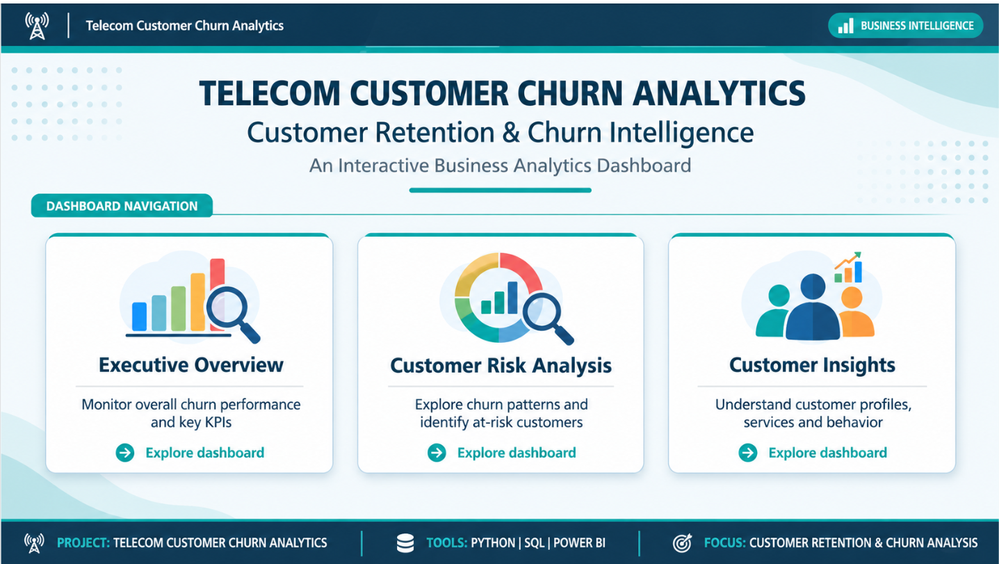
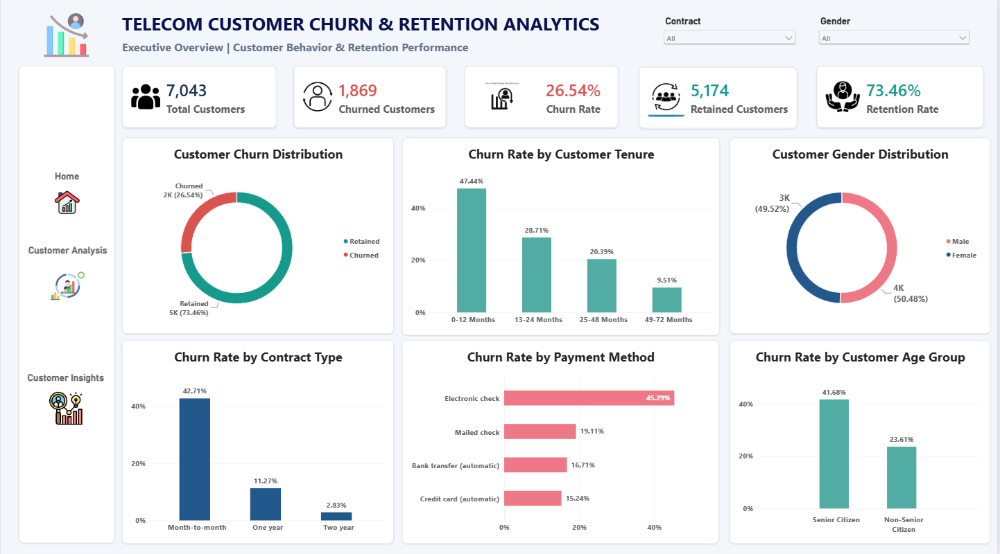
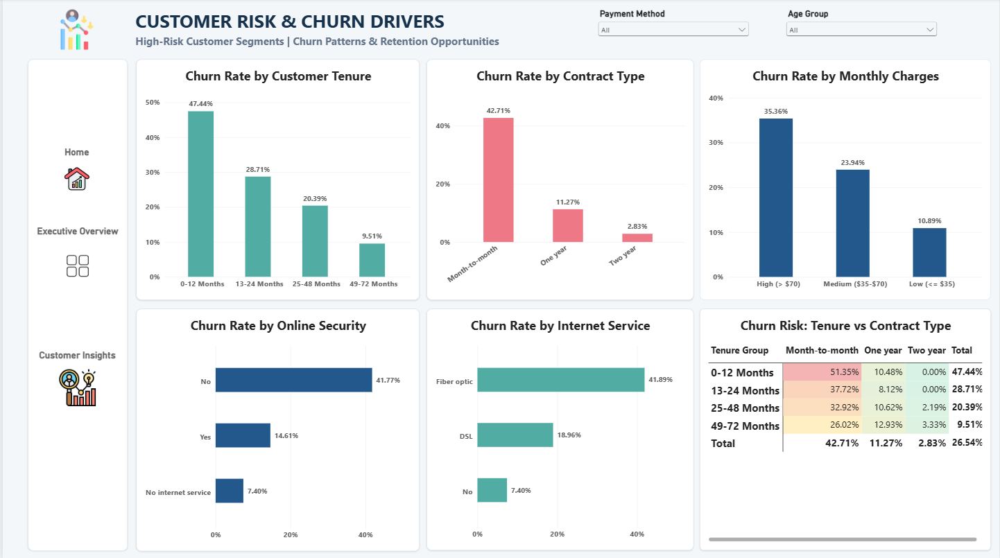
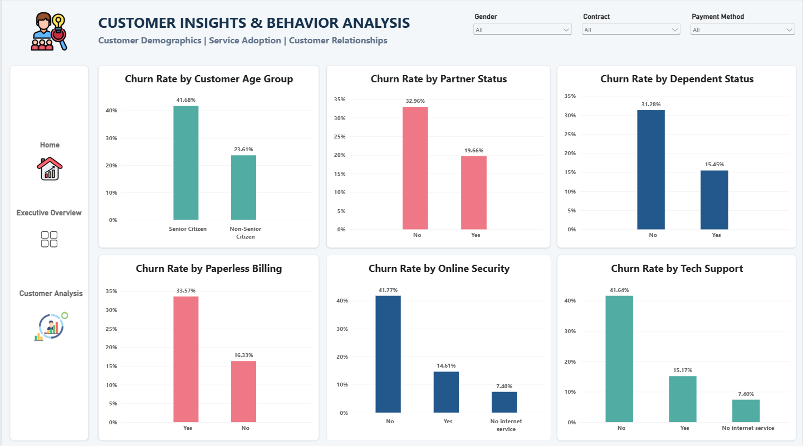

# Telecom Customer Churn & Retention Analytics

An end-to-end Data Analytics portfolio project exploring customer churn patterns, identifying high-risk customer segments, and developing data-driven retention recommendations.

## Project Overview

Customer churn is a major challenge for subscription-based businesses. This project analyzes customer data to understand why customers leave, which customer segments have higher churn rates, and what businesses can do to improve customer retention.

The project follows a complete analytics workflow using spreadsheet analysis, SQL, Python, and Power BI.

## Business Objectives

- Analyze overall customer churn and retention.
- Identify customer segments with the highest churn rates.
- Examine the relationship between customer behavior and churn.
- Investigate contract types, payment methods, tenure, and service preferences.
- Identify combinations of factors associated with higher churn.
- Develop actionable business recommendations.
- Present insights through an interactive Power BI dashboard.

## Dataset

- **Dataset:** IBM Telco Customer Churn
- **Total Records:** 7,043 customers
- **Original Columns:** 21
- **Target Variable:** Churn
- **Churned Customers:** 1,869
- **Retained Customers:** 5,174

The dataset contains customer demographics, subscribed services, account information, billing details, tenure, and churn status.

## Tools & Technologies

| Tool | Purpose |
|---|---|
| WPS Spreadsheet | Data cleaning and spreadsheet analysis |
| MySQL | Database management and SQL business analysis |
| Python | Exploratory Data Analysis (EDA) |
| Pandas & NumPy | Data manipulation and analysis |
| Matplotlib & Seaborn | Data visualization |
| Jupyter Notebook | Python analysis environment |
| Power BI | Interactive dashboard development |
| WPS Writer | Project documentation |

## Project Workflow

### 1. Spreadsheet Analysis
- Imported and inspected the raw dataset.
- Identified missing values and data quality issues.
- Created a cleaned TotalCharges field.
- Performed customer churn and segment analysis.
- Developed business insights and an executive summary.

### 2. SQL Business Analysis
- Created the `telecom_churn_analysis` database.
- Imported and validated 7,043 customer records.
- Developed 70 SQL business analysis queries.
- Analyzed churn across customer demographics, contracts, services, and payment methods.

### 3. Python Exploratory Data Analysis
- Performed data inspection and cleaning.
- Analyzed categorical and numerical variables.
- Conducted individual and combined customer risk analysis.
- Explored correlations and customer behavior patterns.
- Created visualizations and documented findings.

### 4. Power BI Dashboard
Developed three interactive dashboard pages:

- **Executive Overview:** Overall customer, churn, and retention performance.
- **Customer Risk Analysis:** Churn patterns across tenure, contracts, payment methods, internet services, and monthly charges.
- **Customer Insights:** Customer demographics, relationships, and subscribed services.

## Power BI Dashboard Preview

### 1. Project Overview


### 1. Executive Overview


### 2. Customer Risk Analysis


### 3. Customer Insights & Behavior Analysis


## Key Findings

| Business Metric | Result |Add complete Telecom Customer Churn Analytics projec
|---|---:|
| Total Customers | 7,043 |
| Churned Customers | 1,869 |
| Retained Customers | 5,174 |
| Overall Churn Rate | 26.54% |
| Retention Rate | 73.46% |

### Highest-Risk Customer Segments

| Customer Segment | Churn Rate |
|---|---:|
| Month-to-Month Contracts | 42.71% |
| 0–12 Months Tenure | 47.44% |
| Electronic Check Payment | 45.29% |
| Fiber Optic Internet | 41.89% |
| High Monthly Charges | 35.36% |

### Combined Risk Analysis

Some combinations of customer characteristics showed particularly high churn rates:

- Fiber Optic + Month-to-Month Contract: **54.61%**
- Electronic Check + Month-to-Month Contract: **53.73%**
- High Monthly Charges + Month-to-Month Contract: **52.69%**
- 0–12 Months Tenure + Month-to-Month Contract: **51.35%**

These findings indicate associations in the analyzed dataset, not proof of causation.

## Business Recommendations

1. Develop targeted retention strategies for month-to-month customers.
2. Improve onboarding and customer support during the first 12 months.
3. Investigate pricing concerns among customers with higher monthly charges.
4. Encourage electronic payment alternatives where appropriate.
5. Improve the customer experience for fiber optic service users.
6. Strengthen online security and technical support service adoption.

## Project Limitations

- The analysis is based on historical customer data.
- The project identifies patterns and associations; it does not establish causation.
- No machine learning churn prediction model was developed.
- Eleven records contained blank original TotalCharges values. Cleaned zeros were used as placeholders because these records had zero tenure.
- Complete cost data was unavailable, so profit and profit-margin metrics were not calculated.

## Repository Structure

```text
Telco-Customer-Churn/
│
├── 01_Dataset/
│   └── Telco_Customer_Churn_Raw.csv
│
├── 02_WPS_Analysis/
│   └── Telco_Customer_Churn_Working.xlsx
│
├── 03_SQL_Analysis/
│   ├── Telecom_Churn_Business_Analysis.sql
│   └── Telecom_Churn_SQL_Analysis_Report.docx
│
├── 04_Python_Analysis/
│   └── Notebooks/
│       └── Telecom_Churn_EDA.ipynb
│
├── 05_PowerBI_Dashboard/
│   └── Telecom_Customer_Churn_Analytics.pbix
│
├── 06_Documentation/
│   ├── Telecom_Customer_Churn_Analytics_Project_Report.docx
│   ├── Telecom_Customer_Churn_Analytics_Project_Report.pdf
│   └── Dashboard_Screenshots/
│       ├── 01_Executive_Overview.png
│       ├── 02_Customer_Risk_Analysis.png
│       └── 03_Customer_Insights.png
│
└── README.md
```

## Project Deliverables

- Spreadsheet-based data cleaning and analysis.
- SQL database and 70 business analysis queries.
- Python EDA Jupyter Notebook.
- Interactive Power BI dashboard.
- Complete project documentation in Word and PDF formats.
- Dashboard screenshots.

## Conclusion

This project demonstrates an end-to-end data analytics workflow, from raw customer data preparation to business analysis, visualization, and actionable recommendations.

It highlights practical skills in spreadsheet analysis, SQL, Python, data visualization, Power BI, and business problem-solving.

---

**Project Category:** Data Analytics | Customer Churn | Business Intelligence

**Author:** Aleeza Habib

**LinkedIn:** [Connect with me on LinkedIn](https://www.linkedin.com/in/aleezahabib/)
